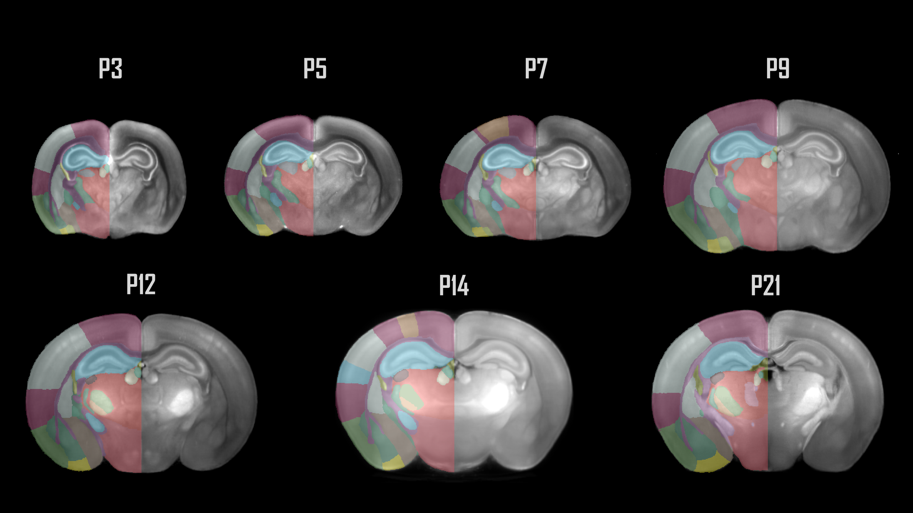
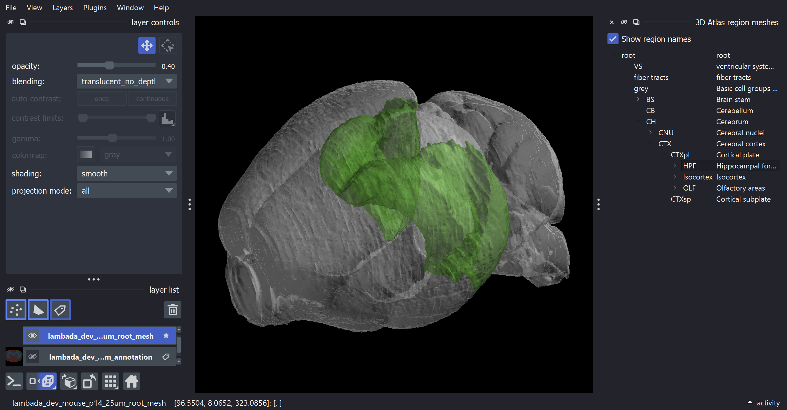

# The LAMBADA developmental mouse brain atlases have been added to BrainGlobe

The structure of cerebral vasculature continues to develop after birth, but its spatiotemporal dynamics have always been unclear. To address this, [de Launoit et al. (2026)](https://doi.org/10.1016/j.cell.2026.03.013) created the light-sheet-aligned mouse brain annotated developmental atlas (LAMBADA) to align spatial transcriptomics data on key genes governing vascular development. Using seven different timepoints in development (P3, P5, P7, P9, P12, P14 and P21), the authors provide high resolution light-sheet fluorescence microscopy (LSFM) templates which are volume-corrected to in-vivo MRI benchmarks, ensuring that this developmental atlas reflects the natural brain growth trajectories as seen in development. We have packaged this atlas into BrainGlobe to make this resource useable throughout the BrainGlobe ecosystem. This also presents an exciting opportunity for future tools to be developed around spatial transcriptomic data in our upcoming data API. 

We have packaged the following atlases: 
* `lambada_dev_mouse_p3_25um`
* `lambada_dev_mouse_p5_25um`
* `lambada_dev_mouse_p7_25um`
* `lambada_dev_mouse_p9_25um`
* `lambada_dev_mouse_p12_25um`
* `lambada_dev_mouse_p14_25um`
* `lambada_dev_mouse_p21_25um`

**Figure 1. Coronal sections of the 7 developmental timepoints covered by LAMBADA.**

## How do I use the new atlases?

You can use the LAMBADA developmental mouse brain atlases for visualisation like other BrainGlobe atlases, as written below:

* Install BrainGlobe ([instructions](/documentation/index))
* Open napari and follow the steps in our [download tutorial](/tutorials/manage-atlases-in-GUI.md) for the LAMBADA developmental mouse brain atlas
* Visualise the different parts of the atlas as described in our [visualisation tutorial](/tutorials/visualise-atlas-napari)

The end result will look something like Figure 2.

**Figure 2: The P14 LAMBADA Developmental Mouse Brain atlas visualised with `brainrender-napari`: with mesh overlays for the brain (grey) and the hippocampal formation (green).**

## Why are we adding new atlases?

A fundamental aim of the BrainGlobe project is to make various brain atlases easily accessible by users across the globe. If you would like to get involved with a similar project, please [get in touch](/contact).
